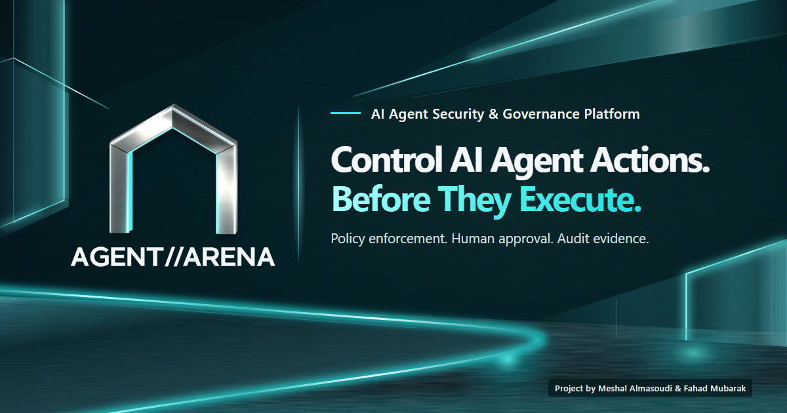
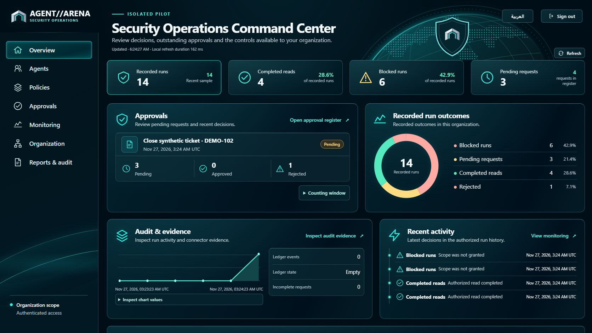

# AGENT//ARENA

**AI Agent Security & Governance Platform**  
AI proposes. Policy decides.

A support agent can read a ticket. Who can authorize closing it? AGENT//ARENA checks the authenticated caller, the organization’s policy and the tool grant before an action takes effect. The project runs in an isolated enterprise test environment with synthetic records.
[Watch the English product film](evidence/index.html#launch-film) · [الفيلم بالعربية](ar/evidence/index.html#launch-film)

[العربية](README_AR.md) · [Watch the console recording](media/enterprise-console.mp4) · [Inspect the two-organization case](docs/LOCAL_PILOT.md)

## Follow one decision

In the two-organization exercise, an authorized read reached a separate local ticket service over TLS. A proposed change without the right grant left the ticket revision untouched. A sensitive close waited for a different reviewer and executed once. Reusing the approval returned HTTP 409. The other organization received HTTP 404 when it requested the protected record. A restored copy of the audit history passed its local integrity check. [Case and diagram](docs/LOCAL_PILOT.md) · [Redacted result record](docs/ENTERPRISE_RESULTS.json)

## What was measured

| Evidence | Result and scope |
| --- | --- |
| Hosted Linux · 27 November 2026 · 686f29d | **1,004 distinct Python cases**. Both interpreters passed the same 967 general cases. PostgreSQL 17.12 passed all 37 additional cases. The 24 Node tests passed. |
| Local Chrome · 686f29d | The timeline kept delayed events with their run in ten transitions in each language. The original reviewer recovered a journal receipt after a lost acknowledgement. |
| Offline benchmark | **9 deterministic scenarios**, zero model calls. The text indicator flagged one benign example. |
| Hosted gates · 686f29d | **4 of 8 jobs passed** per event. Tooling static analysis, advisories, secret scanning and container vulnerabilities remained open. |
| Earlier live connector trial · 21 November 2026 | One authorized read of a public synthetic GitHub issue and one Groq summary, both HTTP 200. Matching input hashes identified the issue content. The retained evidence supports connectivity. Summary quality was not independently scored. |

The illustrated `DEMO-102` scenario is a deterministic fixture. Local code supplied the proposed action and model assessment. The real policy gateway denied a close during a summary task. The separate live connector trial did not run this scenario. [Fixture case and screenshots](docs/CASE_STUDY.md) · [Evidence by date](docs/EVIDENCE_AND_LIMITS.md)

## Explore locally

From this website directory, run `python -m http.server 8765 --bind 127.0.0.1`. Open `http://127.0.0.1:8765/` or `http://127.0.0.1:8765/ar/`. Choose an outcome in the decision lab and evaluate the proposal. The static presentation works offline. Stop the preview with Ctrl+C. The review package contains the proposed update to the existing [GitHub Pages website](https://miish-7.github.io/agent-arena-pro-showcase/).

[Interactive decision lab](lab/index.html) · [Simulated administration console](console/index.html) · [Evidence explorer](evidence/index.html) · [Architecture](docs/ARCHITECTURE.md) · [Real product captures](docs/DEMO.md) · [Institutional evaluation roadmap](docs/ENTERPRISE_ROADMAP.md)

**Project by Meshal Almasoudi & Fahad Mubarak.** [Project decisions](docs/PROJECT_ROLE.md) · [Rights and reuse](RIGHTS_AND_REUSE.md)

## Local technical qualification

Three concurrent submissions resulted in one HTTPS read. Denial and a pending review produced no change at a separate synthetic receiver. After approval, three deliveries resulted in a single persisted effect. The bilingual evidence page links the observed scope and the recorded review transaction. [Qualification and recording](evidence/index.html#qualification)

## Seven views from the running console

Follow a service identity from its tool grants to a versioned policy, a human decision and an auditable run. The screenshots come from an isolated, authenticated session with synthetic records. [Inspect all seven views](evidence/index.html#console-captures) · [Watch an action review](media/decision-proof.mp4)

In the earlier, pre-correction recording session on 27 November 2026, local Chrome checks covered all seven views, two languages and three viewport sizes (42 combinations). Four authorized roles were checked on each page in both languages (56 combinations). All 20 Node cases passed locally. The earlier hosted results above retain their original date.

The latest gallery follows a reviewer from service inventory to policy scope, an approval decision and its audit evidence. Each capture comes from the authenticated console. The example counts belong to the synthetic workspace shown in that recording.

[Verify the three redacted decision records offline](docs/decision-sample/README.md).

A small local Qwen evaluation used an explicitly selected synthetic ticket. In English and Arabic, an authorized read succeeded, a read-only identity’s close proposal was denied, and an eligible close required a separate reviewer. Both runs repeated the same requests. [Model evaluation and observed ticket states](docs/ENGINEERING_REVIEW.md).
