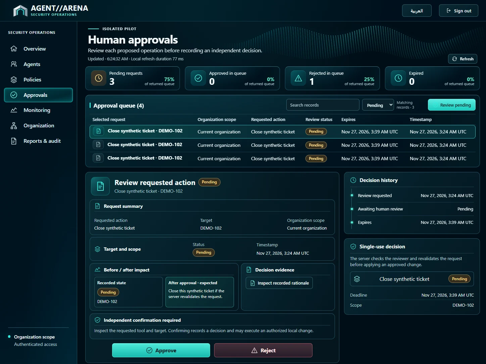

#  AGENT//ARENA

**AI Agent Security & Governance Platform** · [العربية](README_AR.md)

A support agent can read a ticket. Should it be able to close it? AGENT//ARENA puts an independent policy gateway in front of the tool that changes the record. A security team can trace who requested the change, which policy applied, who approved it and what happened to the ticket.

[Open the showcase](https://miish-7.github.io/agent-arena-pro-showcase/) · [Watch the 75-second film](https://miish-7.github.io/agent-arena-pro-showcase/media/launch/MAIN_PRODUCT_FILM_EN.mp4) · [Try the decision lab](https://miish-7.github.io/agent-arena-pro-showcase/lab/) · [Inspect the evidence](https://miish-7.github.io/agent-arena-pro-showcase/evidence/)

**1,004 distinct Python cases passed · 24 Node tests passed** on the frozen engineering release, `686f29d`. The hosted results and open security gates are [documented together](docs/EVIDENCE_AND_LIMITS.md).

## What happened when Qwen asked to close a ticket?

We ran **Qwen2.5-0.5B-Instruct on a local CPU**, with the same six requests in English and Arabic. In both languages, an authorized read reached a separate ticket service. When the model proposed closing the ticket under a read-only identity, the gateway denied the write. The ticket stayed **open at revision 0**.

With a grant to request closure, the same kind of proposal waited for a separate reviewer. Test automation signed in as that reviewer. After confirmation the ticket closed **once, at revision 1**. A second confirmation returned HTTP 409.

Two local runs at revision `32aab5c` produced 24 model outputs on this fixed set. We recorded abstentions separately from policy denials. The film shows a separate deterministic exercise on synthetic data. [Read the bilingual Qwen evaluation](docs/ENGINEERING_REVIEW.md#follow-up-with-a-structured-target) · [Inspect the recorded fixture](docs/CASE_STUDY.md)

## How a proposal reaches a tool

The model proposes an action and a target. The gateway checks the authenticated identity, organization, tool grant and current policy. The result determines what the connector can do.

| Gateway decision | What happens to the ticket |
| --- | --- |
| **Allow** | A scoped read reaches the local ticket service. The service returns the authorized record. |
| **Deny** | A close request outside the caller’s grant stops before the write. The ticket revision stays the same. |
| **Require approval** | A different reviewer approves the specific action. The server rechecks authority, expiry and ticket revision before committing the change. |

The organization-scoped audit trail connects the decision and policy version to the approval and resulting effect. In the two-organization test, the other organization’s report request returned HTTP 404. [Explore the interactive architecture](https://miish-7.github.io/agent-arena-pro-showcase/architecture/) · [Trace the two-organization case](docs/LOCAL_PILOT.md) · [Verify three redacted records offline](docs/decision-sample/README.md)

*The approvals view was captured from the authenticated application using synthetic organization records.* [View all seven console screens](https://miish-7.github.io/agent-arena-pro-showcase/evidence/#console-captures)

## Verification and release status

| What was tested | Observed result |
| --- | --- |
| Hosted Linux · 27 November 2026 | Python 3.12 and 3.13 each passed the same 967 general cases. The mandatory PostgreSQL 17.12 job passed 37 more with zero skips. **967 + 37 = 1,004 distinct Python cases.** All **24 Node tests** passed. |
| Offline text indicator | Nine deterministic scenarios, zero model calls and one false positive on a benign example. |
| Release gates | Four of eight hosted jobs passed per event. Tooling static analysis, dependency advisories, secret-scanner matches and container vulnerability findings remain open. |

The published showcase documents an isolated engineering testbed. Production qualification remains open. An earlier, separately authorized GitHub/Groq trial recorded one issue read and one completion. [Dated results and limits](docs/EVIDENCE_AND_LIMITS.md) · [Evaluation roadmap](docs/ENTERPRISE_ROADMAP.md)

**Developed by Meshal Almasoudi & Fahad Mubarak.** [Engineering decisions](docs/PROJECT_ROLE.md) · [Media rights and reuse](RIGHTS_AND_REUSE.md) · [Run the static showcase locally](docs/LOCAL_PILOT.md#safe-quick-start-for-the-static-showcase)
