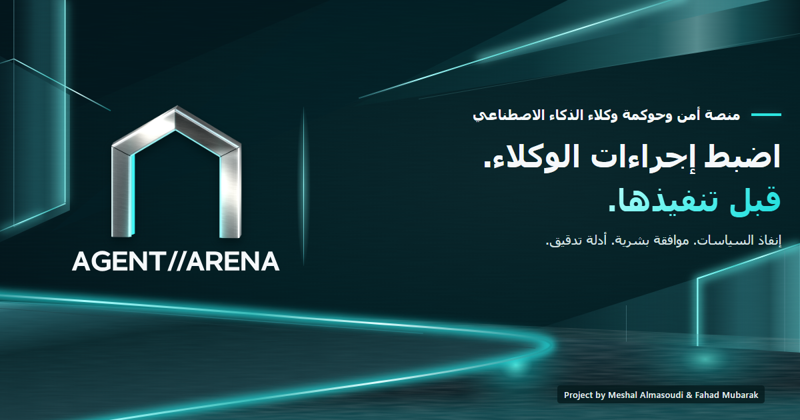
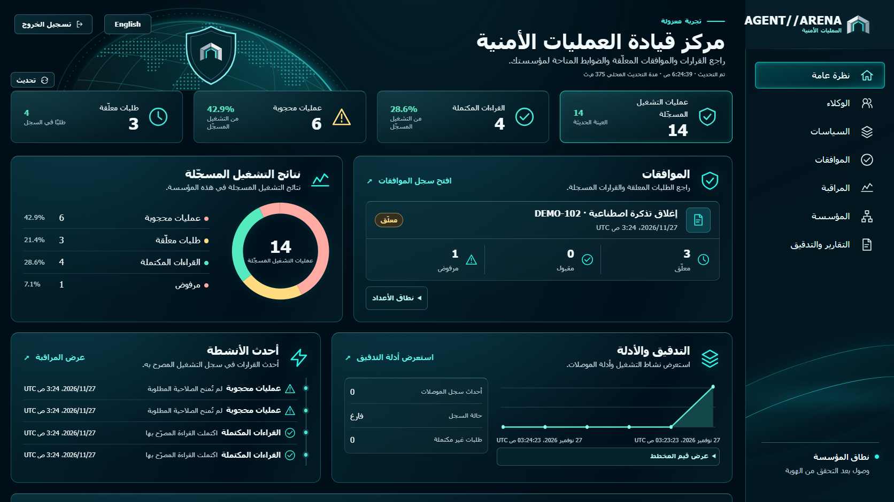

# AGENT//ARENA

**منصة أمن وحوكمة وكلاء الذكاء الاصطناعي**  
الذكاء الاصطناعي يقترح، والسياسات تحكم التنفيذ.  
AI proposes. Policy decides.

[شاهد فيلم المشروع بالعربية](ar/evidence/index.html#launch-film) · [الفيلم بالإنجليزية](evidence/index.html#launch-film)

مُنح وكيل دعم صلاحية قراءة تذكرة. فمن يملك الإذن بإغلاقها؟ تتحقق المنصة من هوية طالب الإجراء، وسياسة مؤسسته، وصلاحيته لاستخدام الأداة قبل تغيير حالة التذكرة. تعمل النسخة الهندسية في بيئة اختبار مؤسسية معزولة ببيانات اصطناعية.

[English](README.md) · [شاهد تسجيل لوحة الإدارة](media/enterprise-console.mp4) · [تتبّع تجربة المؤسستين](docs/LOCAL_PILOT_AR.md)

## تتبّع قرارًا واحدًا

في تجربة مؤسستين، وصلت القراءة المصرّح بها إلى خدمة تذاكر محلية منفصلة عبر اتصال TLS. وعندما طلب الوكيل تغييرًا خارج صلاحيته، بقي رقم مراجعة التذكرة على حاله. انتظر الإغلاق الحساس مراجعًا آخر، ثم نُفّذ مرة واحدة. عند تكرار الموافقة أعاد الخادم HTTP 409. وعندما طلبت المؤسسة الأخرى السجل المحمي، تلقت HTTP 404. اجتاز سجل التدقيق المحلي فحص السلامة بعد استعادة نسخة من البيانات. [تجربة المؤسستين ومخططها](docs/LOCAL_PILOT_AR.md) · [سجل النتائج المنقّح](docs/ENTERPRISE_RESULTS.json)

## ما الذي قِيس فعليًا؟

| الدليل | النتيجة ونطاقها |
| --- | --- |
| تحقق Linux المستضاف، 27 نوفمبر 2026 · 686f29d | نجحت **1004 حالات Python مميزة**، منها 967 عامة على كل مفسر و37 على PostgreSQL 17.12 دون تخطٍّ. نجحت اختبارات Node الـ24. |
| اختبار Chrome المحلي · 686f29d | ظلّت الأحداث المتأخرة مرتبطة بتشغيلها في عشر حالات انتقال بكل لغة. واستعاد المراجع الأصلي إيصال قيد بعد فقدان التأكيد. |
| المعيار المحلي | **تسعة سيناريوهات حتمية** بلا استدعاء لنموذج. أصدر مؤشر فحص النص إنذارًا كاذبًا واحدًا على مثال سليم. |
| البوابات المستضافة · 686f29d | نجحت **4 من 8 وظائف** لكل حدث. بقيت بوابات أدوات التحليل الساكن والاعتماديات وفحص الأسرار وثغرات الحاوية مفتوحة. |
| تجربة اتصال سابقة، 21 نوفمبر 2026 | جرت قراءة واحدة مخوّلة لتذكرة GitHub عامة اصطناعية، وتلخيص واحد عبر Groq. أعادت العمليتان HTTP 200. تطابقت بصمة المدخل في السجلين. دقة الملخص لم تُقيّم بصورة مستقلة. |

أما `DEMO-102` المصوّرة فهي **حالة اختبار حتمية**. ولّد منطق الاختبار اقتراح الإجراء والتقييم المرافق له محليًا، ثم رفضت بوابة السياسات الفعلية محاولة الإغلاق أثناء مهمة التلخيص. اقتصر الاتصال الحي السابق على تلخيص تذكرة واحدة بتفويض مستقل. [دراسة الحالة واللقطات](docs/CASE_STUDY.md) · [الأدلة بحسب التاريخ](docs/EVIDENCE_AND_LIMITS.md)

## تجربة الموقع محليًا

شغّل الأمر `python -m http.server 8765 --bind 127.0.0.1` من مجلد الموقع، ثم افتح `http://127.0.0.1:8765/ar/` للعربية أو `http://127.0.0.1:8765/` للإنجليزية. اختر نتيجة في مختبر القرار وقيّم الاقتراح. تعمل مواد العرض دون اتصال خارجي. ينتهي التشغيل بالضغط على Ctrl+C. تحتوي حزمة المراجعة على التحديث المقترح [لعنوان المشروع الحالي على GitHub Pages](https://miish-7.github.io/agent-arena-pro-showcase/ar/).

[مختبر القرار التفاعلي](ar/lab/index.html) · [محاكاة لوحة الإدارة](ar/console/index.html) · [استكشاف الأدلة](ar/evidence/index.html) · [المعمارية](docs/ARCHITECTURE.md) · [لقطات المنتج الفعلية](docs/DEMO.md) · [خارطة التقييم المؤسسي](docs/ENTERPRISE_ROADMAP.md)

Project by Meshal Almasoudi &amp; Fahad Mubarak

[القرارات الهندسية](docs/PROJECT_ROLE.md) · [حقوق المواد واستخدامها](RIGHTS_AND_REUSE.md)

## التأهيل التقني المحلي

وصل طلب قراءة واحد إلى الخدمة المستقلة لثلاثة طلبات متزامنة. ظل مخزن الاستقبال الاصطناعي دون تغيير بعد الرفض وأثناء انتظار الموافقة. وبعد الموافقة أحدثت ثلاث محاولات تسليم تحديثًا واحدًا. [الأدلة ومشاهدة جلسة المراجعة](ar/evidence/index.html#qualification)

## سبع شاشات من اللوحة الفعلية

استعرض جرد الوكلاء والسياسة السارية وطلب الموافقة وسجل القرار من منظور المؤسسة المخوَّلة. تعرض اللقطات بيانات اصطناعية أُنشئت في بيئة محلية معزولة. [اللقطات السبع](ar/evidence/index.html#console-captures) · [شاهد مراجعة إجراء](media/decision-proof.mp4)

في جولة توثيق سابقة للتصحيح يوم 27 نوفمبر 2026، اختبرنا محليًا الشاشات السبع بلغتين وعلى ثلاثة مقاسات في Chrome، بإجمالي 42 حالة عرض. وفحصنا أربعة أدوار على كل صفحة باللغتين في 56 حالة صلاحية. نجحت حالات Node العشرون محليًا. أما النتائج المستضافة أعلاه فتبقى مرتبطة بتاريخها الأصلي.

يبدأ المعرض من هوية الخدمة ونطاق السياسة، ثم يوضح قرار الموافقة ودليله في سجل التدقيق. التُقطت الصور من لوحة التشغيل بعد تسجيل الدخول، وتخص الأعداد سجلات المؤسسة الاصطناعية التي تظهر في كل تجربة.

[تحقق محليًا من عينة قرارات التذكرة](docs/decision-sample/README.md).

في تجربة محلية صغيرة على نموذج Qwen، حُدّدت التذكرة الاصطناعية ضمن سياق الطلب. نجحت القراءة المخوّلة باللغتين العربية والإنجليزية. ورفضت البوابة اقتراح الإغلاق من هوية تملك القراءة فقط، وطلبت موافقة مراجع مستقل عند توفر صلاحية الإغلاق. تكررت الطلبات نفسها في تشغيلين. [تفاصيل التقييم وحالة التذكرة](docs/ENGINEERING_REVIEW.md).
