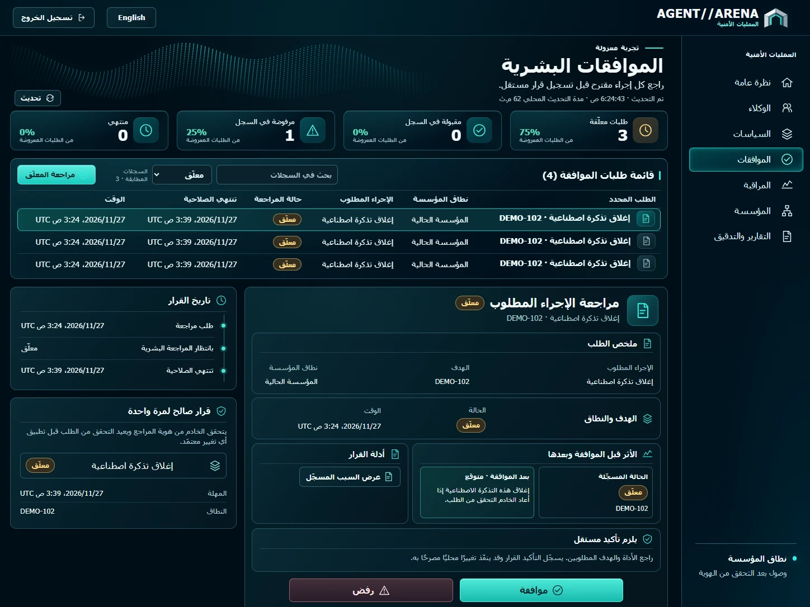

<h1 dir="rtl"> AGENT//ARENA</h1>

**منصة لأمن وكلاء الذكاء الاصطناعي وحوكمة إجراءاتهم** · [English](README.md)

يملك وكيل دعم صلاحية قراءة تذكرة. فمَن يملك صلاحية إغلاقها؟ تضع المنصة بوابة سياسات مستقلة أمام الأداة التي تغيّر السجل. يستطيع فريق الأمن تتبّع صاحب الطلب والسياسة التي حَكَمَت القرار وهوية المراجع، ثم التحقق مما تغيّر فعليًا في التذكرة.

[افتح الموقع](https://miish-7.github.io/agent-arena-pro-showcase/ar/) · [شاهد الفيلم في 75 ثانية](https://miish-7.github.io/agent-arena-pro-showcase/media/launch/MAIN_PRODUCT_FILM_AR.mp4) · [جرّب مختبر القرار](https://miish-7.github.io/agent-arena-pro-showcase/ar/lab/) · [استعرض الأدلة](https://miish-7.github.io/agent-arena-pro-showcase/ar/evidence/)

**اجتاز الإصدار الهندسي المجمّد 1004 حالات اختبار مميّزة في Python و24 اختبارًا في Node** عند الالتزام `686f29d`. يجمع [سجلّ التحقق](docs/EVIDENCE_AND_LIMITS.md) بين النتائج المستضافة وبوابات الأمان التي بقيت مفتوحة.

## ماذا حدث عندما اقترح Qwen إغلاق التذكرة؟

شغّلنا نموذج **Qwen2.5-0.5B-Instruct** محليًا على المعالج، واستخدمنا الطلبات الستة نفسها بالعربية والإنجليزية. في اللغتين وصلت القراءة المصرّح بها إلى خدمة التذاكر المستقلة. وعندما اقترح النموذج الإغلاق بحساب مخوّل بالقراءة فقط، رفضت البوابة الكتابة، وبقيت التذكرة **مفتوحة عند المراجعة 0**.

وعندما امتلك الحساب صلاحية طلب الإغلاق، انتظر التنفيذ موافقة مراجع مستقل. استخدمت أتمتة الاختبار حساب ذلك المراجع لتأكيد الطلب. أُغلقت التذكرة **مرة واحدة وانتقلت إلى المراجعة 1**، وأعادت محاولة تأكيد الموافقة مرة أخرى الرمز HTTP 409.

أنتج النموذج 24 مخرجًا في جولتين محليتين على النسخة `32aab5c` بهذه العينة الثابتة. سُجّل امتناعه عن الإجابة منفصلًا عن حالات الرفض التي أصدرتها بوابة السياسات. ويعرض الفيلم تجربة حتمية أخرى ببيانات اصطناعية. [تفاصيل تجربة Qwen باللغتين](docs/ENGINEERING_REVIEW.md#المتابعة-باستخدام-معرّف-تذكرة-محدد) · [دراسة الحالة المصوّرة](docs/CASE_STUDY.md)

## كيف يصل اقتراح الوكيل إلى الأداة؟

يقترح النموذج الإجراء والتذكرة المقصودة. تتحقق البوابة من هوية صاحب الطلب، ومؤسسته، والصلاحية الممنوحة له لاستخدام الأداة، والسياسة السارية. يحدد القرار ما يستطيع الموصل تنفيذه.

| قرار البوابة | الأثر في خدمة التذاكر |
| --- | --- |
| **سماح** | تصل القراءة المخوّلة إلى الخدمة المحلية، وتعيد الخدمة السجل المصرّح بقراءته. |
| **رفض** | يتوقف طلب الإغلاق الخارج عن صلاحيات الحساب قبل الكتابة، ويظل رقم مراجعة التذكرة كما هو. |
| **موافقة بشرية مطلوبة** | يوافق مراجع آخر على الإجراء المحدد. يعيد الخادم التحقق من الصلاحية والمهلة ورقم مراجعة التذكرة قبل تثبيت التغيير. |

يربط سجل التدقيق الخاص بالمؤسسة القرار وإصدار السياسة بمرجع الموافقة وأثر التنفيذ. وفي تجربة المؤسستين، أعاد طلب التقرير من المؤسسة الأخرى الرمز HTTP 404. [استكشف المعمارية التفاعلية](https://miish-7.github.io/agent-arena-pro-showcase/ar/architecture/) · [تتبّع تجربة المؤسستين](docs/LOCAL_PILOT_AR.md) · [تحقّق محليًا من ثلاثة سجلات منقّحة](docs/decision-sample/README.md)

*التُقطت شاشة الموافقات من التطبيق بعد تسجيل الدخول باستخدام سجلات مؤسسة اصطناعية.* [استعرض شاشات لوحة الإدارة السبع](https://miish-7.github.io/agent-arena-pro-showcase/ar/evidence/#console-captures)

## نتائج التحقق وحالة الإصدار

| نطاق الاختبار | النتيجة المرصودة |
| --- | --- |
| تحقق Linux المستضاف في 27 نوفمبر 2026 | نجحت الحالات العامة الـ967 نفسها على Python 3.12 و3.13. ونجحت 37 حالة إضافية في الوظيفة الإلزامية لقاعدة PostgreSQL 17.12 دون تخطٍّ. **المجموع 1004 حالات Python مميزة**. ونجحت **اختبارات Node الأربعة والعشرون**. |
| مؤشر تحليل النص دون اتصال | شمل القياس تسعة سيناريوهات حتمية، بصفر استدعاءات للنموذج وإنذار كاذب واحد على مثال سليم. |
| بوابات الإصدار | نجحت أربع من ثماني وظائف في كل حدث مستضاف. بقيت مفتوحة بوابات التحليل الساكن للأدوات، وتنبيهات الاعتماديات، ومطابقات فحص الأسرار، وثغرات الحاوية. |

يوثّق الموقع المنشور التجارب في مختبر هندسي معزول. وما زالت متطلبات التشغيل الإنتاجي قيد التقييم. وفي تجربة اتصال سابقة بتفويض منفصل، سُجّلت قراءة تذكرة واحدة من GitHub وتوليد ملخص واحد عبر Groq. [الأدلة المؤرخة وحدودها](docs/EVIDENCE_AND_LIMITS.md) · [خارطة التقييم](docs/ENTERPRISE_ROADMAP.md)

<strong>Developed by Meshal Almasoudi &amp; Fahad Mubarak.</strong>

[القرارات الهندسية](docs/PROJECT_ROLE.md) · [حقوق المواد واستخدامها](RIGHTS_AND_REUSE.md) · [تشغيل الموقع محليًا](docs/LOCAL_PILOT_AR.md)

