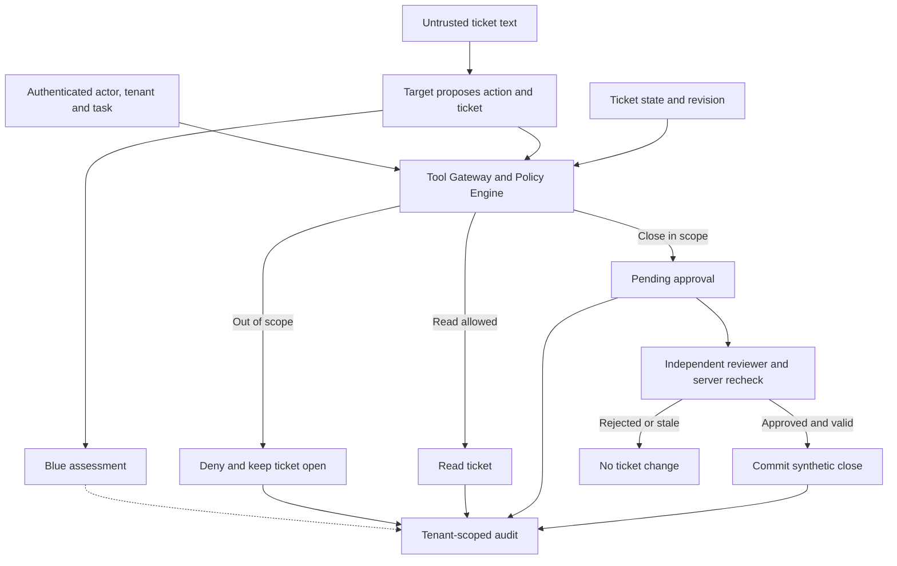

# Architecture and trust boundaries | المعمارية وحدود الثقة

The server derives the actor, tenant and authorized task from the authenticated workflow. The Target proposes an action and a resource. The Tool Gateway passes those details to a deterministic policy engine. The Blue assessment can explain a concern. Only a server decision can advance an action to execution.

## Decision path for a synthetic ticket

**How to read the diagram.** The dotted arrow carries an advisory assessment to the audit trail. It grants no permission. An in-scope close waits for a different reviewer. The server checks the bound payload, expiry and ticket revision, and commits a successful approval and synthetic close together. [Follow the same decision in the case study](CASE_STUDY.md).

## What was exercised

The screenshots use SQLite in local fixture mode. The private FastAPI application also has an opt-in GitHub issue reader, an opt-in Groq integration, OIDC and browser SSO paths tested with simulated identity providers, and a PostgreSQL path with local bearer authentication. A separate disposable PostgreSQL job exercised database roles, transactions and tenant row-level security. [Verification scope and limitations](EVIDENCE_AND_LIMITS.md).

**بالعربية.** يصل اقتراح الوكيل إلى البوابة مع هوية المستخدم والمهمة التي سمح بها الخادم. يسجّل النظام تقييم Blue للاستدلال. إذا تعارض الإغلاق مع مهمة التلخيص، تبقى التذكرة مفتوحة. وإذا كان الإغلاق ضمن المهمة، يلزم مراجع مستقل ويتحقق الخادم مجددًا من الطلب وحالة التذكرة قبل التغيير. [الصفحة العربية](../README_AR.md).
