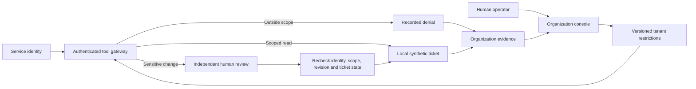

# From a proposed tool action to a recorded decision

[العربية](LOCAL_PILOT_AR.md) · [Return to the showcase](../index.html) · [Stable verification evidence](EVIDENCE_AND_LIMITS.md)

An agent may read a support ticket when its assigned task permits that read. A request to close the ticket changes the question. The gateway needs an authorized service identity, the organization's current rules, the granted scope and an independent human decision before a permitted local closure can take effect.

## How the boundaries fit together



The English and Arabic console reads recorded data from the authenticated organization. Its overview shows outcomes and the status of local controls. Its management views expose permissions, policy revisions, pending reviews, membership and run evidence according to the human's server-assigned role.

| Review question | Where the boundary is enforced | Evidence to inspect |
|---|---|---|
| Can an agent expand its own permission? | An authenticated human administrator manages agent scopes and tenant policy revisions. | Organization access history and policy revision history |
| Can a request cross organizations? | The backend derives the scope from the authenticated principal. | Negative authorization checks with two synthetic organizations |
| Can approval outlive a policy change? | The gateway rechecks authorization, policy revision and current ticket state. | Approval outcome and its recorded decision |
| What happens when a chain check fails? | The protected connector validates recorded history before egress. | Connector ledger status and allowed run exports |

## Two-organization pilot

One HTTPS GET returned the approved synthetic ticket. A request without its grant was refused. The close remained pending until the test approved it through a separately authenticated reviewer account. The stored ticket then moved to revision 1. Cross-organization access returned 404. A stopped connector returned 503. The authorized JSON report included the decision events. Their integrity was verified again after restoring the synthetic database.

On 25 November 2026, the hosted Linux evidence for revision 264cfe5 recorded 965 distinct Python cases. Python 3.12 and 3.13 each passed the same 928 general cases. A real PostgreSQL 17.12 job passed all 37 additional cases without skips. All 17 Node cases passed. Nine fixed benchmark scenarios made zero model calls. The authenticated console was also checked locally in Chrome on Windows and Linux.

The released evidence identifies the Linux image used for the run, restart and scan. Tooling SAST, software-composition and container vulnerability gates remain open. Production qualification requires a separate decision. For a pending or approved action, the organization-scoped PDF and JSON export include the approval reference and the action’s SHA-256 fingerprint. A separately computed fingerprint matched both exports and the recorded decision. Reviewer identity stays in authorized JSON and audit records. Four decision states were checked, and a different organization received HTTP 404. [Redacted release evidence](ENTERPRISE_RESULTS.json)

## Reviewing the exhibits

The existing [screen recording](../media/fixture-demo.mp4) and [decision case study](CASE_STUDY.md) follow a deterministic fixture. A separate, previously authorized trial read one public synthetic GitHub issue and used one Groq completion. The static showcase plays local media and has no application account or provider interface. [Recording guide](DEMO.md) · [Evidence and limitations](EVIDENCE_AND_LIMITS.md)

The earlier merged research release passed 761 distinct Python cases and 13 Node cases. Both generations ran the same nine fixed benchmark scenarios. The exhibits do not establish a customer pilot, certification, service-level objective or independent off-host audit retention.

## Safe quick start for the static showcase

Extract the reviewed public-safe site into an empty directory. From that directory, run the following command with Python 3. A browser opened to `http://127.0.0.1:8765/` can read the English site and its Arabic version at `/ar/`. Stop the preview with Ctrl+C.

```console
python -m http.server 8765 --bind 127.0.0.1
```

The authenticated product, disposable database and local operator credentials belong to the private evaluation environment. No private application source, credential or database is needed for this preview.

## Reporting a concern and reuse

Contact the project owner through an agreed private channel before sharing any potentially sensitive evidence. Describe the affected version, the behavior and its impact. Share only synthetic, redacted examples. Confirm a confidential receiving channel and response owner before a broader pilot. Rights, author credit, permitted reuse and outstanding license decisions are recorded in [Rights and reuse](../RIGHTS_AND_REUSE.md). [Evaluation roadmap](ENTERPRISE_ROADMAP.md) · [Project contributions and engineering decisions](PROJECT_ROLE.md)

## Actual local console

27 November 2026 · Actual local session on the presentation-only console revision. Its disposable data and organization-scoped observations belong to this session. The previously recorded two-organization evaluation is documented above. [Open the desktop capture](../assets/enterprise-overview-en.png) · [Open the mobile capture](../assets/enterprise-overview-en-mobile.png)

[Watch the recorded security console](../media/enterprise-console.mp4) · [English captions](../media/enterprise-console.en.vtt) · [Arabic captions](../media/enterprise-console.ar.vtt)

The English and Arabic captures cover the enterprise management console. The optional read-only SSO session page uses English controls and is outside the recorded walkthrough.
