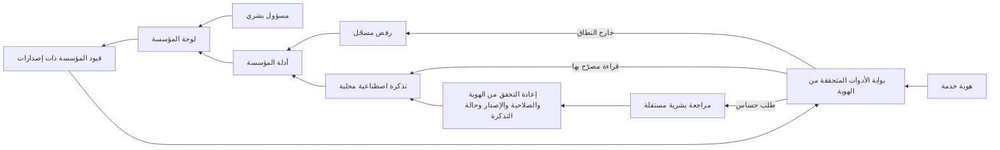

# من اقتراح الوكيل إلى القرار الموثّق

[English](LOCAL_PILOT.md) · [العودة إلى موقع العرض](../ar/index.html) · [أدلة الإصدار البحثي](EVIDENCE_AND_LIMITS.md)

يجوز للوكيل قراءة تذكرة دعم عندما تسمح مهمته بالقراءة. أما إغلاق التذكرة فيغيّر حالتها. قبل تنفيذ الإغلاق المحلي، تتحقق بوابة الأدوات من هوية الخدمة وقواعد المؤسسة الحالية والصلاحية الممنوحة وقرار مراجع بشري مستقل.

## تجربة المؤسستين الموثّقة

جلب طلب HTTPS واحد التذكرة الاصطناعية المصرّح بها. رفضت البوابة الإجراء الذي افتقر إلى إذن الأداة. ظل الإغلاق معلّقًا حتى نفّذت أتمتة الاختبار الموافقة عبر حساب مراجع مستقل، ثم تغيّرت حالة التذكرة وأصبح رقم مراجعتها 1. أعاد طلب بيانات المؤسسة الأخرى 404، وأعاد توقف الموصّل 503. تضمّن تقرير JSON المصرّح به أحداث القرار، وأُعيد التحقق من سلامتها بعد استعادة قاعدة البيانات الاصطناعية.

وثّقت أدلة Linux المستضافة بتاريخ 25 نوفمبر 2026 للنسخة 264cfe5 نجاح 965 حالة Python مميزة. نجحت الحالات العامة الـ928 على كلّ من Python 3.12 و3.13، ونجحت الحالات الـ37 الإضافية على PostgreSQL 17.12 الحقيقي دون تخطٍّ. نجحت حالات Node الـ17. وعملت تسعة سيناريوهات ثابتة دون استدعاء نموذج. واختُبرت لوحة الإدارة بعد تسجيل الدخول محليًا في Chrome على Windows وLinux.

تحدّد الأدلة صورة Linux المبنية والمشغّلة والمفحوصة. تبقى بوابات التحليل الساكن للأدوات وفحص الاعتماديات وثغرات الحاوية مفتوحة. يتطلب التشغيل الإنتاجي قرارًا مستقلًا. في حالة الانتظار وبعد الموافقة، يتضمّن PDF وتصدير JSON المخوّلان للمؤسسة مرجع الموافقة وبصمة الإجراء SHA-256. تطابقت بصمة محسوبة بصورة مستقلة مع التقريرين وسجل القرار. تبقى هوية المراجع في سجل التدقيق وJSON المخوّل. شمل الفحص أربع حالات قرار، وتلقت المؤسسة الأخرى الاستجابة HTTP 404. [نتائج التحقق المنقّحة](ENTERPRISE_RESULTS.json)

## كيف تتكامل الضوابط؟



تعرض لوحة الإدارة العربية والإنجليزية بيانات المؤسسة المصادق عليها. وتُظهر النظرة العامة نتائج التشغيل وحالة الضوابط المحلية. تتحدد صلاحيات عرض النطاقات ومراجعات السياسات والطلبات المعلّقة والعضوية وأدلة التشغيل وفق الدور الذي يعيّنه الخادم.

| سؤال المراجعة | الضابط الذي يطبَّق | الدليل المتاح للمراجعة |
|---|---|---|
| هل يستطيع الوكيل توسيع صلاحياته؟ | يدير مسؤول بشري مصادق عليه نطاقات الوكيل ومراجعات سياسة المؤسسة. | سجل إدارة الهويات وسجل مراجعات السياسة |
| هل يمكن لطلب عبور حدود المؤسسة؟ | يستمد الخادم نطاق المؤسسة من هوية صاحب الطلب. | حالات رفض ضمن تجربتين لمؤسستين اصطناعيتين |
| هل تبقى الموافقة صالحة بعد تغيّر السياسة؟ | تتحقق البوابة مجددًا من التفويض ومراجعة السياسة والحالة الراهنة للتذكرة. | قرار الموافقة ونتيجة تنفيذه |
| ماذا يحدث عند فشل فحص السجل؟ | يفحص الموصل المحمي سلامة تاريخه قبل السماح بالخروج. | حالة سجل الموصل وتقارير التشغيل المصرح بها |

## قراءة مواد العرض

يعرض [التسجيل](../media/fixture-demo.mp4) و[توثيق حالة القرار](CASE_STUDY.md) سيناريو اصطناعيًا حتميًا. وفي تجربة سابقة منفصلة ومصرّح بها، قُرئت تذكرة اصطناعية عامة واحدة من GitHub وأُرسل طلب إكمال واحد إلى Groq. يشغّل موقع العرض ملفات وسائط محلية، ولا يحتوي على حساب في التطبيق أو واجهة اتصال بمزوّد. [دليل التسجيل](DEMO.md) · [الأدلة وحدودها](EVIDENCE_AND_LIMITS.md)

اجتاز الإصدار البحثي المدمج السابق 761 حالة Python مميزة و13 حالة Node. وشغّل الجيلان تسعة سيناريوهات معيارية ثابتة. وتبقى تجربة العميل والاعتماد الأمني وأهداف الخدمة والاحتفاظ المستقل بالأدلة خارج المضيف من متطلبات التأهيل التشغيلي.

## تشغيل موقع العرض بأمان

فك ضغط نسخة العرض المراجعة في مجلد فارغ. من داخل المجلد شغّل الأمر التالي باستخدام Python 3، ثم افتح `http://127.0.0.1:8765/` للإنجليزية أو أضف `/ar/` للعربية. لإيقاف المعاينة اضغط Ctrl+C.

```console
python -m http.server 8765 --bind 127.0.0.1
```

يعمل التطبيق المصادق عليه وقاعدة البيانات المؤقتة وبيانات دخول المشغّل داخل بيئة التقييم الخاصة. لا تتطلب المعاينة شيفرة التطبيق الخاص أو بيانات اعتماده أو قاعدة بياناته.

## الإبلاغ عن مشكلة وإعادة الاستخدام

تواصل مع صاحب المشروع عبر قناة خاصة متفق عليها قبل مشاركة أدلة قد تكون حسّاسة. اذكر الإصدار المتأثر والسلوك المرصود وأثره واستخدم أمثلة اصطناعية منقَّحة فقط. قبل تجربة ميدانية أوسع، ينبغي تحديد قناة سرية لاستقبال البلاغات ومسؤول الاستجابة. يوثّق [بيان الحقوق](../RIGHTS_AND_REUSE.md) نسب العمل وشروط إعادة الاستخدام والقرارات المتبقية المتعلقة بالترخيص. [خارطة التقييم](ENTERPRISE_ROADMAP.md) · [مساهمات المشروع وقراراته الهندسية](PROJECT_ROLE.md)

## لقطات فعلية من اللوحة المحلية

٢٧ نوفمبر ٢٠٢٦ · جلسة فعلية محلية بإصدار العرض البصري المحدّث للوحة الإدارة. تخص البيانات المؤقتة والمشاهدات المقيّدة بالمؤسسة هذه الجلسة. توثّق الفقرات السابقة تجربة المؤسستين التي أُجريت سابقًا. [فتح لقطة الحاسوب](../assets/enterprise-overview-ar.png) · [فتح لقطة الهاتف](../assets/enterprise-overview-ar-mobile.png)

[شاهد التسجيل الفعلي للوحة المؤسسية](../media/enterprise-console.mp4) · [النص العربي](../media/enterprise-console.ar.vtt) · [النص الإنجليزي](../media/enterprise-console.en.vtt)

تغطي اللقطات باللغتين لوحة الإدارة المؤسسية. تستخدم صفحة جلسة الدخول الموحد الاختيارية المخصصة للقراءة عناصر تحكم إنجليزية، وهي خارج نطاق التسجيل.
